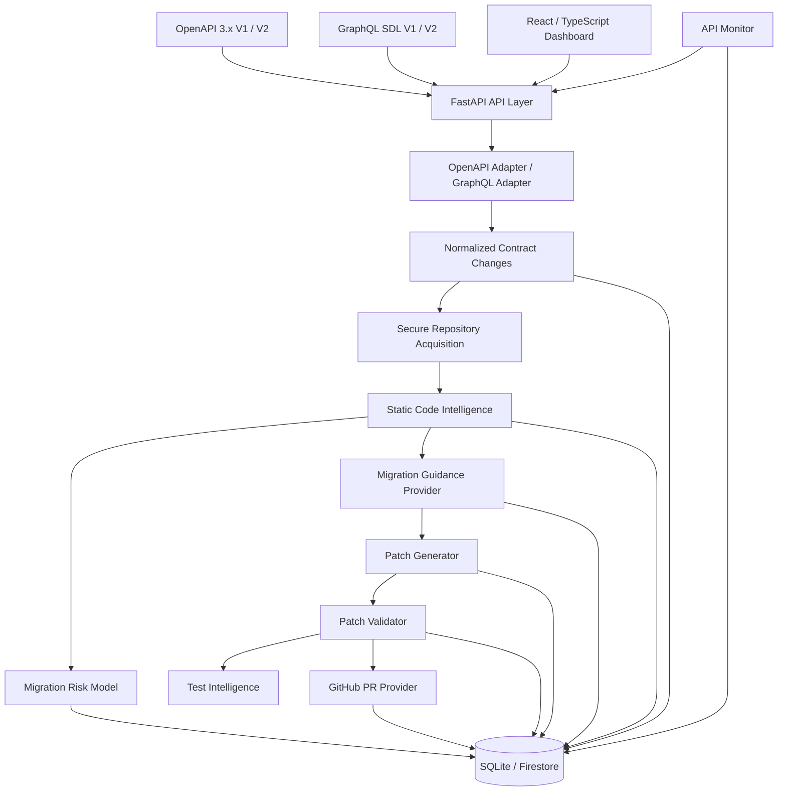

# DriftGuard AI

[](https://github.com/anaghathakur/Driftguard-AI/actions/workflows/ci.yml)

**Detect breaking API changes before they break production code.**

DriftGuard AI is an API Change Impact & Migration Intelligence Platform that detects OpenAPI 3.x and GraphQL SDL contract drift, identifies affected source code across repositories, estimates migration risk, generates migration guidance, proposes bounded code changes, validates those changes statically, discovers related tests, and prepares human-reviewed GitHub Pull Requests.

The platform is designed around one principle:

> API changes should be detected, understood, and reviewed before they become production failures.

---

## What DriftGuard Does

When an upstream API changes, developers often need to manually determine:

- What changed?
- Is the change breaking?
- Which repository files depend on it?
- Which wrappers and callers are indirectly affected?
- How risky is the migration?
- What code needs to change?
- Which tests should be reviewed?
- Is the proposed migration ready for human review?

DriftGuard connects these steps into one workflow.

```text
API V1
   ↓
API V2
   ↓
Contract Drift Detection
   ↓
Breaking Change Classification
   ↓
Repository Impact Analysis
   ↓
Dependency / Caller Tracing
   ↓
Migration Risk Prediction
   ↓
Migration Guidance
   ↓
Proposed Code Patch
   ↓
Static Validation
   ↓
Test Intelligence
   ↓
Review Readiness
   ↓
GitHub Pull Request
   ↓
Human Review
```

DriftGuard does **not** automatically merge or deploy code.

---

## Product Workflow

The frontend organizes the migration workflow into five stages:

### 1. Detect

Compare an existing OpenAPI 3.x or GraphQL SDL contract with a newer version.

DriftGuard classifies changes as:

- breaking
- potentially breaking
- non-breaking

Examples include removed endpoints, newly required request fields, removed GraphQL fields or arguments, nullability changes, and changed types.

### 2. Understand

Analyze an uploaded repository ZIP or supported GitHub repository and connect contract changes to likely source-code usage.

For supported languages, DriftGuard can trace:

```text
POST /payments
      ↓
payment_client.create_payment
      ↓
checkout.checkout
      ↓
order_service.submit_order
```

The result includes direct API usages, wrapper callers, transitive callers, evidence locations, confidence, and impact depth.

### 3. Fix

DriftGuard generates migration guidance and can create a bounded proposed code patch.

Patch generation is grounded in:

- detected API changes
- impacted source symbols
- repository evidence
- migration recommendations
- migration risk
- verified repository content

The patch is a **proposal**. Repository files are not modified during generation.

### 4. Validate

DriftGuard reconstructs the proposed patch in memory and performs static migration checks.

Validation can detect:

- missing required request fields
- removed request fields still being used
- endpoint or HTTP-method mismatches
- caller signature inconsistencies
- stale-value propagation
- edits outside the approved patch scope
- related tests
- test gaps

Validation produces one of three readiness states:

```text
READY_FOR_REVIEW
NEEDS_REVIEW
BLOCKED
```

`READY_FOR_REVIEW` means the bounded static checks found no blocking or meaningful unresolved migration issue.

It does **not** mean the application is safe to deploy.

### 5. Review

For eligible GitHub-backed analyses, DriftGuard can prepare a review branch and GitHub Pull Request.

PR creation is:

- explicit
- human-controlled
- validation-gated
- snapshot-verified
- idempotent

DriftGuard never automatically merges or deploys the Pull Request.

---

## Key Features

### Multi-contract Comparison

DriftGuard accepts OpenAPI 3.x JSON/YAML and GraphQL SDL `.graphql`/`.gql` documents and performs deterministic contract comparison through an internal adapter layer.

The comparison pipeline supports local JSON Pointer `$ref` resolution and identifies API changes relevant to migration impact.

For GraphQL, it statically validates SDL and classifies type, field, input-field, argument, enum, nullability, list-shape, and return-type changes. Stable operation identities such as `Mutation.createPayment` flow through the same impact, risk, migration, patch, validation, report, and GitHub Check pipeline as HTTP operations.

The existing `POST /api/v1/specifications/compare` route remains the OpenAPI-compatible API. New clients can use `POST /api/v1/contracts/compare` with `contract_type=auto|openapi|graphql`.

---

### Repository Impact Analysis

Repositories can be analyzed from:

- uploaded ZIP archives
- supported public GitHub repositories

Repository archives are treated as untrusted input.

ZIP processing includes protections against:

- path traversal
- absolute paths
- ZIP slip
- encrypted files
- symbolic/special files
- duplicate archive paths
- oversized archives
- excessive compression ratios
- excessive file counts
- oversized individual files

Repository source code is scanned in memory.

It is not executed.

---

## Deep Code Impact Intelligence

DriftGuard performs deeper static analysis for:

- Python
- JavaScript
- TypeScript
- JSX
- TSX

Python analysis uses AST-based inspection.

JavaScript and TypeScript use conservative bounded static parsing.

The analyzer identifies:

- functions and methods
- local imports
- HTTP request anchors
- statically resolvable URLs
- symbol relationships
- direct API calls
- wrapper functions
- transitive callers

Example:

```text
POST /payments
  -> payment_client.create_payment    direct API usage, depth 0
  -> checkout.checkout                wrapper caller, depth 1
  -> order_service.submit_order       transitive caller, depth 2
```

Each match can retain:

- file path
- source location
- language
- enclosing symbol
- impact depth
- confidence
- evidence trace

Unsupported or unresolved cases fall back to lexical matching where possible.

Repository code is never imported, compiled, executed, tested, or passed to package tooling.

---

## Automatic API Monitoring

DriftGuard can subscribe to a remote HTTPS contract or a contract file in a
workspace-authorized GitHub App repository. Supported contract formats are OpenAPI
JSON/YAML and GraphQL SDL. Manual file comparison remains a separate first-class
workflow.

A monitor stores:

- monitor name
- source type (public HTTPS URL or connected GitHub file)
- remote contract URL or a repository-relative contract path
- optional consumer repository (a contract-only subscription produces comparison,
  risk, and migration guidance but does not claim source impact or generate a patch)
- optional branch/tag/ref
- check interval
- current specification baseline
- specification hash
- check history

The monitoring lifecycle is:

```text
Create monitor
      ↓
Fetch and validate current specification
      ↓
Store bounded baseline
      ↓
Future check
      ↓
Compare SHA-256
      ↓
Unchanged → record check only
Changed   → persist a comparison, then run repository impact analysis when a repository is configured
Failed    → retain previous baseline for retry
```

A successful changed check advances the stored baseline only after the analysis succeeds.

---

## Remote Contract Security

Remote specifications are fetched through a bounded HTTPS-only acquisition layer.

DriftGuard rejects URLs containing or resolving to unsafe destinations such as:

- localhost
- private network ranges
- link-local addresses
- multicast/reserved ranges
- cloud metadata destinations
- embedded credentials
- unsupported ports
- URL fragments

Redirects are validated individually.

Remote content is bounded by configured size and timeout limits before being passed
into the OpenAPI or GraphQL validator. Downloaded contracts are never executed.

GitHub-file subscriptions accept only a server-resolved connected repository and a
path confined to that repository. DriftGuard obtains a short-lived GitHub App
installation token server-side; the browser never supplies a personal access token.

DNS validation occurs before each request. Network-level egress restrictions are still recommended for stronger production isolation against DNS-rebinding scenarios.

---

## Automatic Scheduler

The built-in monitor scheduler runs inside the FastAPI process.

It:

- checks enabled monitors
- skips monitors that are not yet due
- prevents overlapping checks within the process
- isolates individual monitor failures
- shuts down cleanly with the API

The scheduler is disabled by default.

Enable it with:

```text
DRIFTGUARD_MONITOR_SCHEDULER_ENABLED=true
DRIFTGUARD_MONITOR_POLL_SECONDS=30
DRIFTGUARD_MONITOR_CHECK_LEASE_SECONDS=900
```

The current scheduler is process-local.

When enabled, a single API worker should be used. Distributed monitoring would require an external scheduler or worker architecture.

---

## Migration Risk Prediction

DriftGuard includes a local machine-learning risk classifier.

The current model uses a versioned feature schema and produces:

- migration-risk score
- risk level
- class probabilities
- explainable top drivers
- model provenance

The selected model is Logistic Regression.

The committed model is reproducible from deterministic synthetic training data.

Example training configuration:

```text
Samples: 4000
Seed: 42
Split: 75/25 stratified
```

Current synthetic held-out evaluation:

| Candidate | Accuracy | Balanced Accuracy | Macro-F1 |
| --- | ---: | ---: | ---: |
| Logistic Regression | 0.908000 | 0.906750 | 0.904413 |
| Random Forest | 0.888000 | 0.886599 | 0.883029 |

These numbers describe performance against generated synthetic labels only.

They are **not** evidence of real-world production accuracy.

Risk classification is intended to prioritize engineering review, not automatically approve migrations or deployments.

---

## Migration Guidance

DriftGuard can generate structured migration recommendations for detected API changes.

The provider system is replaceable.

Supported modes include:

```text
deterministic
mock
gemini
```

The deterministic provider is the default rules-based migration planner. It derives guidance
from normalized contract changes, impact evidence, and risk metadata without requiring an LLM.
The mock provider is retained only for explicit development/test compatibility and is never
accepted by production configuration.

Optional Gemini integration receives bounded, structured, secret-redacted context rather than an entire repository.

Provider output is schema validated before it enters the application.

Repository content is treated as hostile untrusted data.

---

## Proposed Code Patches

Patch generation is an explicit developer action after repository-impact analysis.

DriftGuard uses the exact analyzed repository snapshot and generates structured edits containing:

- target file
- original source anchor
- replacement source
- reason
- related API change

The provider does not directly control Git diff metadata.

Before an edit is accepted, DriftGuard verifies:

- path safety
- target file scope
- unique original text anchor
- duplicate edits
- overlapping edits
- context limits
- replacement limits
- diff limits

Python output must remain syntactically parseable with `ast.parse`.

JavaScript and TypeScript use conservative static validation.

Structured edits are applied only to source strings held in memory.

DriftGuard then generates the unified diff using trusted application code.

No repository files are modified during patch generation.

---

## Patch Validation and Test Intelligence

Validation is a separate explicit action.

For GitHub-backed analyses, DriftGuard securely re-fetches and verifies the repository snapshot.

For ZIP-backed analyses, the exact original archive must be uploaded again because repository archives are not persisted.

The validated patch is reconstructed from stored structured edits rather than blindly trusting a stored diff.

DriftGuard then re-runs static code intelligence against the patched in-memory repository.

Validation checks can include:

- required request fields
- removed request fields
- endpoint and method compatibility
- modified function signatures
- resolved callers
- stale-value propagation
- patch blast radius
- edit scope

Example:

```text
POST /payments
email removed
customer_id required
        ↓
payment-client patch proposed
        ↓
contract checks pass
        ↓
checkout still passes order["email"]
into customer_id
        ↓
NEEDS_REVIEW
```

Dynamic or unresolved behavior produces warnings or `UNKNOWN` findings rather than false certainty.

---

## Test Intelligence

DriftGuard discovers potentially related tests statically.

Python conventions include:

```text
test_*.py
*_test.py
tests/
```

JavaScript and TypeScript conventions include:

```text
*.test.*
*.spec.*
__tests__/
```

Test relevance is classified as:

```text
HIGH
MEDIUM
LOW
```

A discovered test means DriftGuard found a static relationship.

It does **not** mean the test was executed or that runtime coverage exists.

Missing tests for important impacted symbols are reported as explicit test gaps.

---

## Review Readiness

Patch readiness is deterministic.

AI providers cannot choose the final readiness state.

### BLOCKED

A definite static problem exists, such as:

- missing required field
- removed field still being sent
- incompatible caller
- invalid patch scope

### NEEDS_REVIEW

Meaningful uncertainty remains, such as:

- unresolved dynamic behavior
- stale-value propagation
- missing direct tests
- migration uncertainty

### READY_FOR_REVIEW

No blocking or meaningful unresolved issue was found by the bounded static checks.

`READY_FOR_REVIEW` means human review can proceed.

It does not mean the patch has passed runtime tests or is safe to deploy.

---

## GitHub Pull Request Workflow

Eligible `READY_FOR_REVIEW` patches can be turned into GitHub Pull Requests.

The PR workflow requires:

- GitHub-backed analysis
- immutable resolved source commit
- persisted patch proposal
- exact validation relationship
- verified repository snapshot
- `READY_FOR_REVIEW` readiness

`NEEDS_REVIEW` and `BLOCKED` validations cannot be overridden.

ZIP-backed analyses can use the rest of DriftGuard but cannot automatically infer the canonical repository required for PR creation.

---

### Human-Controlled PR Creation

The frontend first performs a read-only PR preview.

The preview displays information such as:

- repository
- immutable base commit
- deterministic branch
- modified files
- edit count
- readiness
- validation summary
- test-execution warning

Only a separate explicit confirmation can create the Pull Request.

---

### PR Safety Checks

Immediately before GitHub write operations, DriftGuard:

1. reloads the analysis, patch, and validation;
2. verifies their relationships;
3. verifies the configured repository base;
4. re-fetches the trusted repository snapshot;
5. verifies stored snapshot hashes;
6. reconstructs the persisted patch in memory;
7. verifies reproduced paths and diff;
8. prepares bounded commit and Pull Request metadata.

DriftGuard then creates Git objects for the verified patch.

The branch name follows a deterministic DriftGuard namespace such as:

```text
driftguard/<analysis-id>-<patch-id>
```

Branch updates do not force push.

The repository default branch is never modified directly.

---

### Idempotency

The PR workflow uses a fingerprint based on:

- analysis
- patch
- validation
- repository snapshot
- base commit
- PR workflow profile

Repeated creation requests can reconcile an existing DriftGuard branch, commit, or Pull Request instead of blindly creating duplicates.

---

## Authentication, Workspaces, and Tenant Isolation

The web application has separate public and protected entry points. `/` is the public product
landing page; `/login` and `/signup` present configured identity providers; `/app` and its child
routes require an authenticated session when GitHub auth mode is enabled. The deterministic user A
and user B identities are exposed only at `/dev/login` when both
`DRIFTGUARD_ENVIRONMENT=development` and `DRIFTGUARD_GITHUB_OAUTH_PROVIDER=mock` are set.

GitHub OAuth is the implemented external identity provider. Google sign-in is shown as unavailable
unless a future backend provider is added; DriftGuard does not simulate Google authentication.

DriftGuard separates developer identity from repository authorization:

~~~text
GitHub OAuth login              GitHub App installation
        ↓                                ↓
user + secure browser session  workspace-authorized repositories
        ↓                                ↓
verified workspace membership  immutable source / PR operations
~~~

GitHub OAuth identifies the person using DriftGuard. A GitHub App installation independently
authorizes repository access for one DriftGuard workspace. OAuth access does not grant repository
access, and a GitHub installation cannot be selected for another workspace.

Browser sessions use an opaque, server-hashed session token in an HttpOnly SameSite cookie.
Authenticated state-changing requests also require the server-issued CSRF token. The React client
keeps that token in memory, includes credentials explicitly, and does not store long-lived auth
material in localStorage.

Every request resolves a server-side active workspace and verifies current membership before a
central permission check. Persisted analysis and monitor queries are scoped by workspace; child
patch, validation, report, and Pull Request operations first resolve their workspace-scoped parent.
GitHub installations, repository connections, contracts, dependencies, Check Runs, automation
jobs, and audit events carry the same workspace boundary. Webhooks resolve workspace ownership
only from the trusted installation mapping.

On a user's first successful OAuth callback, DriftGuard idempotently creates one personal
workspace and an Owner membership, then sends the user to `/app/onboarding`. Returning users reuse
their existing memberships. Onboarding offers only real next steps: connect a GitHub App
installation or compare uploaded contracts.

Roles are intentionally small:

- **Owner:** all workspace capabilities, including owner-sensitive organization operations.
- **Admin:** member, repository, analysis, monitor, patch, validation, and PR operations, but no
  owner-only organization action and no ability to modify owners or peer admins.
- **Developer:** read resources; run analyses and monitor checks; generate and validate patches;
  create eligible Pull Requests.
- **Viewer:** read-only access to workspace resources, reports, and audit history.

The final owner cannot be removed or demoted. Cross-workspace identifiers are resolved within the
active workspace and fail without returning the other tenant's data.

### Local development authentication

The default is the deterministic Local Workspace:

~~~dotenv
DRIFTGUARD_ENVIRONMENT=development
DRIFTGUARD_AUTH_MODE=local
~~~

Historical SQLite rows are migrated additively into the stable Local Workspace identifier. Existing
analyses, patches, validations, monitors, PR metadata, and repository configuration are retained.
The legacy membership role **member** is migrated to **developer**.

To exercise the GitHub login flow locally, configure:

~~~dotenv
DRIFTGUARD_ENVIRONMENT=development
DRIFTGUARD_AUTH_MODE=github
DRIFTGUARD_GITHUB_OAUTH_PROVIDER=github
DRIFTGUARD_SESSION_SECRET=replace-with-at-least-32-random-characters
DRIFTGUARD_GITHUB_OAUTH_CLIENT_ID=replace-me
DRIFTGUARD_GITHUB_OAUTH_CLIENT_SECRET=replace-me
DRIFTGUARD_GITHUB_OAUTH_CALLBACK_URL=http://localhost:8000/api/v1/auth/github/callback
DRIFTGUARD_FRONTEND_URL=http://localhost:5173
~~~

For production, set **DRIFTGUARD_ENVIRONMENT=production**. Startup fails closed unless GitHub auth,
real OAuth credentials, a strong session secret, secure cookies, and HTTPS frontend/callback URLs
are configured. Local auth, mock OAuth, mock migration/patch/test-plan providers, mock GitHub
writes, and mock GitHub Checks are prohibited in production. A configured external migration or
test-plan provider failure returns an explicit unavailable response in production instead of
silently returning development mock output. Deterministic migration and patch planning remain
available without external credentials.

Current membership management supports listing members, role changes, and removal. Invitation
delivery, SSO/SAML, SCIM, billing, and enterprise policy controls are intentionally deferred.

---

## GitHub Pull Request Authentication

The default GitHub write provider in the local example is:

```text
mock
```

The mock provider performs no GitHub network write.

Real PR creation uses a GitHub App.

The server:

```text
GitHub App private key
        ↓
short-lived App JWT
        ↓
repository installation
        ↓
installation token
        ↓
GitHub REST API
```

Installation tokens exist only in memory.

DriftGuard does not expose a Personal Access Token input in the frontend.

Private keys, JWTs, installation tokens, and authorization headers are not persisted in analysis storage or returned through APIs.

---

## Optional Real GitHub App Setup

For a controlled demonstration, create a dedicated GitHub App with only the repository permissions required by the workflow:

```text
Contents          Read and write
Pull requests     Read and write
Metadata          Read-only
```

Install it only on a dedicated demo repository.

Store the private key outside the DriftGuard repository.

Configure the backend using your private `.env`:

```text
DRIFTGUARD_GITHUB_APP_ID=<your-app-id>
DRIFTGUARD_GITHUB_APP_PRIVATE_KEY_PATH=<secure-path-to-private-key>
DRIFTGUARD_GITHUB_WRITE_PROVIDER=github_app
```

Never commit the actual private key or `.env`.

For a real acceptance test:

```text
Fresh GitHub-backed analysis
        ↓
Generate proposed patch
        ↓
Validate patch
        ↓
READY_FOR_REVIEW
        ↓
Preview Pull Request
        ↓
Explicitly confirm
        ↓
Pull Request created
```

Stop after PR creation during acceptance testing.

Do not merge the test Pull Request automatically.

---

## Persistence

DriftGuard supports two persistence adapters:

```text
SQLite
Firestore
```

SQLite is the default local persistence layer.

The local database is created under:

```text
data/driftguard.sqlite3
```

unless overridden through configuration.

Persisted information includes bounded records for:

- analyses
- API changes
- repository matches
- risk predictions
- pipeline stages
- failures
- migration recommendations
- patch proposals
- patch validations
- Pull Request workflow records
- API monitors
- monitor checks

Repository archives and complete source trees remain transient.

---

## Reports

Completed analyses can be exported as:

- JSON reports
- PDF reports

Reports can contain available information from:

```text
Analysis
API changes
Repository impact
Risk
Migration guidance
Proposed patches
Patch validation
Test intelligence
GitHub Pull Request metadata
```

Report generation degrades gracefully when later workflow stages have not yet been created.

---

## Health and Readiness

DriftGuard exposes operational endpoints:

```text
GET /health
GET /ready

GET /api/v1/health
GET /api/v1/ready
```

`/health` reports process availability.

`/ready` reports whether the application is ready to serve the configured local workflow without exposing secrets.

The frontend uses readiness information to display provider and service status.

---

## Architecture

DriftGuard is implemented as a modular FastAPI monolith with explicit service and persistence boundaries.



Key architectural principles:

```text
Untrusted input
      ↓
bounded acquisition
      ↓
deterministic parsing
      ↓
structured intelligence
      ↓
human-controlled remediation
```

No repository code execution is required for the core pipeline.

---

## Technology Stack

### Frontend

```text
React
TypeScript
Vite
Tailwind CSS
```

### Backend

```text
Python
FastAPI
Pydantic
SQLite
Firestore adapter
ReportLab
```

### Code Intelligence

```text
Python AST
Static JavaScript/TypeScript analysis
Lexical fallback
Call-graph construction
Impact propagation
```

### Machine Learning

```text
scikit-learn
Logistic Regression
versioned feature schema
joblib artifact
deterministic fallback
```

### AI

```text
Deterministic migration, patch, and test-plan providers
Optional Gemini provider
Structured outputs
Bounded context
Secret redaction
```

### Developer Integration

```text
GitHub archive acquisition
GitHub App authentication
GitHub REST API
GitHub Pull Requests
```

---

## Run Locally

### 1. Clone the repository

```powershell
git clone <your-repository-url>
cd Driftguard-AI
```

### 2. Create the Python environment

From the repository root:

```powershell
python -m venv .venv
```

### 3. Install backend dependencies

```powershell
.\.venv\Scripts\python.exe -m pip install -e ".\apps\api[dev]"
```

### 4. Configure local environment

Copy the example configuration if needed:

```powershell
Copy-Item .env.example .env
```

Do not commit `.env`.

The default local configuration uses local persistence and deterministic providers so the main
product workflow can run without external AI credentials. GitHub writes remain mock in local
development until a server-owned GitHub App is configured.

### 5. Start the backend

```powershell
.\.venv\Scripts\python.exe -m uvicorn apps.api.app.main:app --reload --env-file .env
```

Backend:

```text
http://127.0.0.1:8000
```

Swagger API documentation:

```text
http://127.0.0.1:8000/docs
```

Readiness:

```text
http://127.0.0.1:8000/ready
```

### 6. Install frontend dependencies

Open another PowerShell window:

```powershell
cd apps\web
npm install
Copy-Item .env.example .env
```

### 7. Configure frontend API URL

The frontend reads `apps/web/.env`:

```text
VITE_API_BASE_URL
```

The included example uses:

```text
VITE_API_BASE_URL=http://127.0.0.1:8000
```

### 8. Start the frontend

```powershell
npm run dev
```

Frontend:

```text
http://localhost:5173
```

---

## Demo

The repository includes deterministic Payments API examples intended to demonstrate the DriftGuard workflow without relying on arbitrary third-party services.

Example migration:

### Payments API V1

```text
POST /payments

amount
email
```

### Payments API V2

```text
POST /payments

amount
customer_id
```

The migration can demonstrate:

```text
Contract drift
      ↓
Breaking change
      ↓
payment_client
      ↓
checkout
      ↓
order_service
      ↓
Risk score
      ↓
Migration guidance
      ↓
Proposed patch
      ↓
Patch validation
      ↓
Test intelligence
      ↓
Review readiness
      ↓
Mock or real GitHub PR
```

Sample repository fixtures include states intended to demonstrate both:

```text
payments-needs-review
payments-ready
```

These fixtures are static analysis inputs.

They are not executed by DriftGuard.

---

## Example API Comparison

Sample OpenAPI files are available under:

```text
sample-data/specifications/
```

Example request from Windows PowerShell:

```powershell
curl.exe -X POST http://127.0.0.1:8000/api/v1/specifications/compare `
  -F "old_spec=@sample-data/specifications/payments-old.yaml" `
  -F "new_spec=@sample-data/specifications/payments-new.yaml"
```
GraphQL demo contracts can be compared through the generic route:

```powershell
curl.exe -X POST http://127.0.0.1:8000/api/v1/contracts/compare `
  -F "old_contract=@sample-data/specifications/graphql/payments-old.graphql" `
  -F "new_contract=@sample-data/specifications/graphql/payments-new.graphql" `
  -F "contract_type=graphql"
```

The matching static consumer fixture is:

```text
sample-data/repositories/graphql-payment-client/
```

---

## Example ZIP Repository Analysis

Create a demo archive:

```powershell
Compress-Archive `
  -Path ".\sample-data\repositories\payment-client\*" `
  -DestinationPath "$env:TEMP\payment-client.zip" `
  -Force
```

Use:

```text
POST /api/v1/impact/analyze
```

with:

```text
old_spec
new_spec
repository
```

---

## Example GitHub Repository Analysis

Use:

```text
POST /api/v1/impact/analyze/github
```

with:

```text
old_spec
new_spec
repository_url
ref
```

`ref` may be a branch, tag, or commit.

GitHub acquisition validates trusted GitHub/codeload redirects and enforces repository archive limits before passing content to the secure repository scanner.

The public-URL path scans the downloaded ZIP and bounds total archive entries with
`DRIFTGUARD_MAX_REPOSITORY_FILES`. Connected GitHub ingestion first bounds GitHub's recursive
tree response with `DRIFTGUARD_MAX_REPOSITORY_TREE_ENTRIES`, then downloads only eligible source
blobs. Limit errors identify the exact boundary and report observed and configured values.

The production-oriented defaults remain bounded but accommodate the measured Saleor Dashboard
case: its August 2026 `main` snapshot contained 7,770 Git tree entries, 7,771 ZIP entries, and a
1,450,995-byte generated TypeScript source file; the paired Saleor GraphQL schemas measured about
69,000 AST nodes. Defaults therefore allow 10,000 ZIP entries, 20,000 Git tree entries, 7,500
eligible source files, 2 MiB per source file, and 100,000 GraphQL AST nodes. The independent 5 MiB
GraphQL document, depth-100 AST, 1,000-change, 20 MiB compressed archive, 50 MiB uncompressed
archive, 25 MiB eligible-source, compression-ratio, code-symbol, and graph-edge bounds still apply.
Operators should tune these values from observed workloads without disabling the bounds.

For a GitHub-App-connected repository, **Discover contracts** synchronously resolves the current
default branch to an immutable commit, scans supported candidate paths, validates OpenAPI/GraphQL
contracts, and persists only real discoveries. Discovery does not fabricate a baseline: breaking
change and code-impact analysis still requires two contract versions. The repository table labels
that separate action **Impact analysis** to make the requirement explicit.

---

## API Areas

FastAPI exposes grouped routes for:

```text
Specifications
Impact analysis
Analysis history
Risk predictions
API monitors
Migration recommendations
Patch proposals
Patch validation
Pull Requests
Reports
Health / readiness
```

The complete interactive API contract is available through:

```text
http://127.0.0.1:8000/docs
```

---

## Analysis History

Completed analyses are persisted and can be reopened from the frontend.

Stored analyses include information such as:

- contract changes
- repository matches
- risk predictions
- pipeline execution stages
- migration recommendations
- patches
- validation results
- Pull Request records

Submitting identical versioned inputs may reuse an existing analysis fingerprint instead of creating unnecessary duplicates.

---

## Security Model

DriftGuard treats external data as untrusted.

### OpenAPI input is untrusted

Specifications are validated and bounded before analysis.

### Repository input is untrusted

Archives are scanned for path, size, type, encoding, and compression-related hazards.

### Repository source is never executed

DriftGuard performs static analysis only.

It does not:

```text
import uploaded Python modules
execute uploaded scripts
run npm
run pip
run repository build commands
run repository tests
execute shell commands from repository content
```

### AI output is untrusted

AI providers return structured output that is validated before use.

Providers cannot directly:

```text
choose arbitrary repository paths
bypass patch scope
change review readiness
execute repository code
merge code
deploy code
```

### Secrets are protected

Sensitive credentials should remain in private local/server configuration.

DriftGuard does not intentionally persist:

```text
GitHub App private keys
GitHub App JWTs
GitHub installation tokens
Authorization headers
AI API keys
```

### Patches remain proposals

Patch generation does not modify the repository.

### Validation remains static

Validation does not claim runtime correctness.

### Pull Requests require explicit confirmation

The application does not create a Pull Request merely because an analysis completed.

### No automatic merge or deployment

Human review remains the final decision point.

---

## Configuration

Supported backend configuration is documented in:

```text
.env.example
```

Important configuration areas include:

```text
Application / CORS
Persistence
Remote specification limits
Repository limits
Monitoring
Static-analysis limits
ML model
Migration provider
Patch provider
Patch limits
Validation / test-plan provider
GitHub write provider
GitHub App
```

Do not place real credentials in `.env.example`.

Use a private `.env` or secure server environment for actual secrets.

---

## CORS

Local frontend development supports:

```text
http://localhost:5173
```

Production frontend origins should be supplied through backend configuration rather than hard-coded into application source.

---

## Local Database Reset

For local SQLite development, the default database is:

```text
data/driftguard.sqlite3
```

If you intentionally want a clean local demo environment:

1. stop the backend;
2. make sure no important local analysis history is needed;
3. remove the local SQLite database;
4. restart the API.

DriftGuard does not automatically delete user data for demo resets.

---

## Reports

JSON report:

```text
GET /api/v1/analyses/{analysis_id}/report
```

PDF report:

```text
GET /api/v1/analyses/{analysis_id}/report.pdf
```

Reports may include available analysis, impact, risk, migration, patch, validation, and Pull Request information.

---

## Testing

Every push to `main` and every Pull Request runs the same backend and frontend quality gates in
GitHub Actions. The workflow has read-only repository permissions and receives no application
secrets.

Run the complete backend suite:

```powershell
.\.venv\Scripts\python.exe -m pytest -c apps/api/pyproject.toml apps/api/tests
```

Run Ruff:

```powershell
.\.venv\Scripts\python.exe -m ruff check --config apps/api/pyproject.toml apps/api/app apps/api/tests
```

Frontend lint:

```powershell
cd apps\web
npm run lint
```

Frontend production build:

```powershell
npm run build
```

Check Git whitespace/errors:

```powershell
git diff --check
```

The final product lifecycle tests cover a deterministic flow through contract comparison, repository impact, migration intelligence, patch generation, validation, and review workflow without requiring repository execution.

---

## Training the Local Risk Model

The committed model can be reproduced with:

```powershell
.\.venv\Scripts\python.exe -m apps.api.app.risk.training
```

The training process uses deterministic synthetic data and records information such as:

- dataset hash
- model artifact hash
- feature schema
- split configuration
- training-library versions

The artifact is checksum verified before use.

Only trusted locally configured model artifacts should be loaded because serialized joblib artifacts can execute Python while loading.

---

## Deployment

DriftGuard can always run as a local single-instance application.

A production-style build consists of:

```text
FastAPI backend
React production build
environment-specific configuration
persistent database adapter
```

Frontend production bundle:

```powershell
cd apps\web
npm run build
```

Backend production startup can use the FastAPI application entrypoint with an appropriate ASGI server configuration.

Important deployment considerations:

```text
Configure allowed CORS origins
Protect application access
Store credentials outside source control
Use one worker when process-local monitoring is enabled
Provide network-level egress controls for stronger SSRF protection
Use persistent storage appropriate for the deployment model
```

The built-in scheduler and SQLite configuration are designed primarily for a single-instance MVP.

Distributed workers, queues, and production orchestration are intentionally outside the current implementation.

---

## Known Limitations

DriftGuard AI is a secure-conscious MVP focused on static API migration intelligence and human-reviewed remediation. Its current boundaries are intentional:

- **Contract coverage:** OpenAPI 3.x and GraphQL SDL are supported. OpenAPI local JSON Pointer `$ref` values are resolved. GraphQL support is static SDL and statically discoverable consumer-document analysis: DriftGuard does not introspect arbitrary endpoints, execute resolvers or operations, or infer all federation, runtime-variable, dynamically constructed query, and business-semantic behavior.

- **Repository intelligence:** Python, JavaScript, and TypeScript receive deeper static analysis, including bounded tagged/triple-quoted GraphQL documents and `.graphql`/`.gql` files. Other supported source files use lexical matching. Dynamically constructed URLs or queries, reflection, runtime dependency injection, and external package graphs may not be fully resolved.

- **Repository acquisition:** DriftGuard supports uploaded ZIP archives, public GitHub URLs, and repositories authorized through a workspace-owned GitHub App installation. Production use of connected private repositories still requires the operator to configure and install the real GitHub App.

- **Validation execution:** Static validation is always available. An opt-in process-local runner
  can execute allowlisted pytest or package-manager scripts in development/test only, inside a
  disposable copy. Production requires an external sandbox; with execution disabled, the API
  reports `DEGRADED` and clearly states that repository tests were not executed.

- **Monitoring:** Remote HTTPS monitoring supports static OpenAPI and GraphQL SDL
  documents, and connected GitHub-file subscriptions support the same formats.
  Arbitrary GraphQL introspection is deliberately not implemented. The built-in
  scheduler is process-local and intended for a single-worker MVP.

- **ML risk scoring:** The current risk model is trained and evaluated on deterministic synthetic data. Scores should be used to prioritize engineering review, not as autonomous approval or deployment decisions.

- **Deployment model:** SQLite is appropriate for local and single-instance demonstrations. Firestore is available as an alternative tenant-aware persistence adapter. Authentication, workspaces, RBAC, tenant isolation, and trusted workspace-aware background processing are implemented; distributed queues, invitation delivery, enterprise identity, billing, and production-scale orchestration remain outside this phase.

- **GitHub remediation:** DriftGuard can prepare an explicitly confirmed review branch and Pull Request from a validated patch. It never automatically merges, deploys, releases, or modifies the repository default branch.

---

## Post-MVP Roadmap

Potential next steps include:

- Self-service workspace invitations and enterprise identity providers
- Webhook-driven API and repository monitoring
- Sandboxed CI and test execution
- Additional programming-language analyzers
- Distributed monitoring workers
- Pull Request status synchronization and review feedback
- Real-world calibration of the migration-risk model
- Organization-level migration and security policies
- Protobuf/gRPC contract adapters after the normalized adapter boundary is proven in production usage

---

## Project Summary

**DriftGuard AI — API Change Impact & Migration Intelligence Platform**

Built as a developer platform that compares OpenAPI 3.x and GraphQL SDL contracts, performs static repository dependency analysis across Python, JavaScript, and TypeScript, predicts migration risk, generates migration guidance and bounded code patches, performs static patch validation and test discovery, and prepares human-reviewed GitHub Pull Requests.

Core technologies:

```text
FastAPI
React
TypeScript
Python
Python AST
Static code analysis
Machine Learning
GitHub API / GitHub App
SQLite
Firestore
Gemini integration
OpenAPI
graphql-core
```

DriftGuard is currently a **credible, security-conscious, demonstrable MVP** rather than a claim of production-ready autonomous software maintenance.
